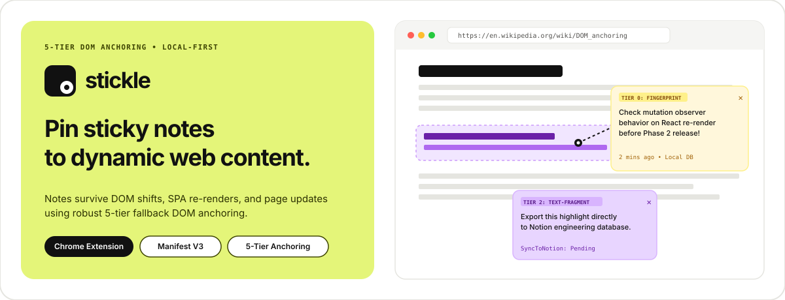
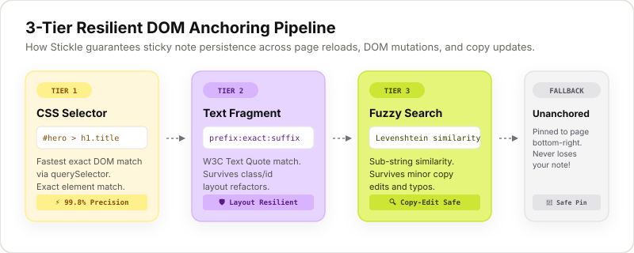

# Stickle — DOM-Anchored Web Sticky Notes



<p align="center">
  <a href="https://chromewebstore.google.com/detail/stickle-%E2%80%94-web-note-anchor/ddahkjckhmgjkjgmmgbpmblogbioneok?hl=en-US&utm_source=ext_sidebar">
    
  </a>
  
  
  
  
  
  
  
</p>

> A free, open-source, local-first Chrome Extension (MV3) that lets you pin persistent floating sticky notes to dynamic web content using a resilient **5-Tier DOM Anchoring System**.
>
> 🚀 **[Add to Chrome (Free on Chrome Web Store)](https://chromewebstore.google.com/detail/stickle-%E2%80%94-web-note-anchor/ddahkjckhmgjkjgmmgbpmblogbioneok?hl=en-US&utm_source=ext_sidebar)**

The Chrome Web Store release is the complete free edition in this repository. It works without an account and keeps notes on your device. A separate commercial wrapper with cloud sync, a hosted dashboard, remote MCP, and team workspaces is in development; none of those paid services are required by or included in the current public release.

---

## 📌 What Ships Today

- 🎯 **Robust 5-Tier DOM Anchoring**: Notes stay pinned across page refreshes, SPA re-renders, Wikipedia DOM shifts, layout refactors, and minor copy edits. Dragged sticky notes and highlighted text notes preserve pixel-accurate offsets.
- 🎨 **Figma-Inspired Color System**: Crisp monochrome frame paired with 7 signature color-block surfaces (`lime`, `lilac`, `cream`, `mint`, `pink`, `coral`, `blue`).
- ✍️ **Text Selection Highlighting**: Highlight text ranges on any webpage with sticky notes attached directly to `<mark>` text elements with exact offset retention.
- 🤖 **Local Model Context Protocol (MCP)**: The stdio server lets local AI clients query, search, create, and summarize exported Stickle notes without a hosted Stickle account.
- 🔒 **Local-First & Private**: Stored in Chrome Local Storage + IndexedDB via Dexie.js. Zero mandatory tracking or telemetry.
- 📦 **JSON Backup & Portable Import/Export**: Export full offline JSON backups (`stickle_export_YYYY-MM-DD.json`) and import/merge them from the extension.
- 🚀 **Manual Notion Export**: Push web notes and highlighted snippets directly from the browser to a Notion database.

## ☁️ Commercial Edition — In Development

The future paid edition is maintained separately in the private `stickle-app` wrapper. Planned commercial capabilities are:

| Plan | Planned additions |
| :--- | :--- |
| **Pro Supporter** | Cross-device cloud sync, hosted notes dashboard, cloud backup, and remote MCP over HTTPS |
| **Teams** | Everything in Pro plus shared workspaces, member roles, author badges, team annotations, and activity history |

These capabilities are not live in the free Chrome Web Store build. Pricing, plan contents, and release timing may change before launch. The local extension, local MCP, manual Notion export, and portable backups remain part of the free open-source edition.

---

## 🏗️ 5-Tier DOM Anchoring System

Stickle solves the problem of brittle web annotations on dynamic modern web apps by using a multi-tiered fallback resolution pipeline.



0. **Tier 0 — DOM Element Fingerprint** *(primary)*: O(1) lookup by `domIndex` (absolute ordinal among all same-tag elements, e.g. the 47th `<p>`) validated against a 60-char `textFingerprint`. Uniquely identifies any element on Wikipedia-style pages with hundreds of repeated tags. Scans ±10 neighbours if index has shifted.
1. **Tier 1 — CSS Selector**: Tries exact DOM matching via optimized CSS selectors (`querySelector`). Fast and precise for stable DOM nodes.
2. **Tier 2 — Text Fragment Quote**: Uses W3C Text Quote matching with exact text, prefix, and suffix contexts. Survives HTML class changes, layout refactors, and framework DOM rebuilds.
3. **Tier 3 — Fuzzy Search**: Uses trigram Dice-coefficient similarity matching against page text nodes. Survives minor copy edits, typos, and phrasing tweaks.
4. **Tier 4 — Stored Page Coordinates**: Absolute `pageX`/`pageY` coords captured at creation time (scroll-independent). Used as a last resort and as the initial position before the DOM is painted.
5. **Tier 5 — Unanchored Fallback**: If element is deleted or page structure changes completely, the note degrades gracefully to a floating page-level note—never losing your content.

**Highlight & Drag Offset Retention**: When sticky notes are dragged or placed on text highlights, their relative `offsetX` and `offsetY` values are preserved relative to target elements and `<mark>` nodes, preventing stickies from snapping back to old positions.

---

## 💻 Running Locally

```bash
# Install dependencies
pnpm install

# Start Extension Dev Server (WXT on http://localhost:3000)
pnpm dev

# Run Type Checks & Unit Test Suite
pnpm compile && pnpm test
```

---

## 🤖 Model Context Protocol (MCP) Integration

The free edition exposes its notes through a local stdio MCP server:

| Mode | Transport | Best for |
| :--- | :--- | :--- |
| **Local stdio** | `npx stickle mcp` | Claude Desktop, Cursor, Windsurf, VS Code, Zed |

| Tool Name | Description |
| :--- | :--- |
| `list_stickle_notes` | List saved notes filtered by domain, tag, or limit |
| `search_stickle_notes` | Full-text search across content, page titles, URLs & tags |
| `get_notes_for_url` | Retrieve all notes anchored to a specific webpage URL |
| `add_stickle_note` | Create and attach a new sticky note to a target webpage URL |
| `export_stickle_summary` | Generate a structured Markdown report grouped by site domain |

### Quick setup — Claude Desktop (local stdio)
Location: `~/Library/Application Support/Claude/claude_desktop_config.json`

```json
{
  "mcpServers": {
    "stickle": {
      "command": "npx",
      "args": ["-y", "stickle", "mcp"],
      "env": {
        "STICKLE_NOTES_PATH": "/Users/yourname/.stickle/notes.json"
      }
    }
  }
}
```

Remote MCP is planned for the commercial edition and is not part of the current public release.

📖 **Full step-by-step setup guide for all clients (Claude Desktop, Cursor, Windsurf, VS Code, Zed) and Cloudflare Workers deployment:** [MCP.md](./MCP.md)

---

## 📄 License

MIT © Stickle Team
